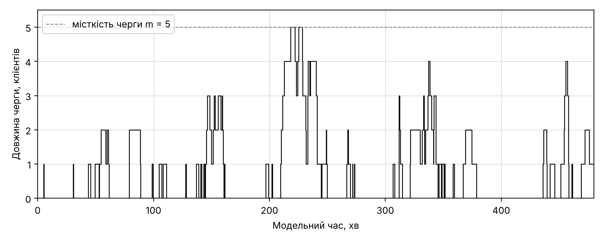
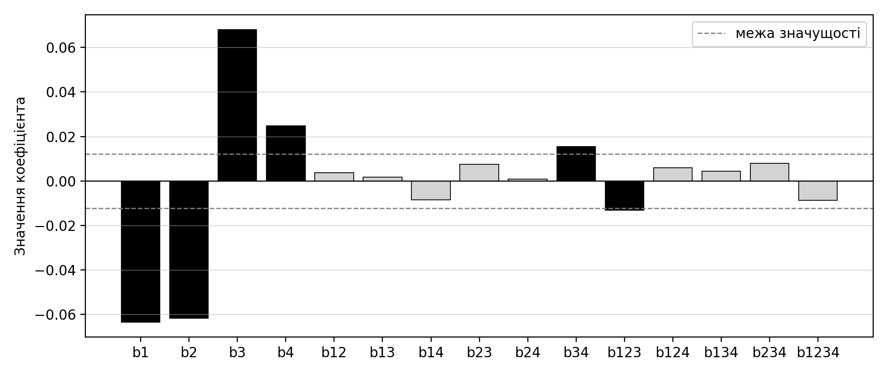

# Імітаційна модель двохпотокової СМО без пріоритетів


Програмна частина курсової роботи з дисципліни **«Імітаційне моделювання
управляючих систем»** на тему **«Розробка імітаційної моделі двохпотокової
системи масового обслуговування без пріоритетів»**.

Це дискретно-подійна імітаційна модель системи масового обслуговування
(СМО) на прикладі **поштового відділення з одним оператором**. Програма
моделює роботу відділення протягом дня, перевіряє модель за аналітичними
формулами і проводить факторний експеримент 2⁴.

Розділи 5 і 6, на які посилається цей опис, — це розділи пояснювальної
записки до курсової роботи. Сама записка до репозиторію не входить.



---

## Зміст

- [Опис об'єкта моделювання](#опис-обєкта-моделювання)
- [Структура проєкту](#структура-проєкту)
- [Встановлення](#встановлення)
- [Запуск](#запуск)
- [Вихідні дані та параметри](#вихідні-дані-та-параметри)
- [Як працює модель](#як-працює-модель)
- [Показники роботи СМО](#показники-роботи-смо)
- [Верифікація](#верифікація)
- [Факторний експеримент](#факторний-експеримент)
- [Результати](#результати)

---

## Опис об'єкта моделювання

До поштового відділення надходять два незалежні пуассонівські потоки клієнтів:

| Потік | Хто це                            | Інтенсивність |
|:-----:|-----------------------------------|:-------------:|
| 1     | клієнти, які **отримують** посилки | λ₁, клієнтів/хв |
| 2     | клієнти, які **відправляють** посилки | λ₂, клієнтів/хв |

- Клієнтів обслуговує **один оператор**. Час обслуговування розподілений
  експоненційно з інтенсивністю μ.
- Черга **спільна** для обох потоків, дисципліна **FIFO**, пріоритетів немає.
- Місткість черги обмежена (**m** місць). Клієнт, який прийшов, коли
  оператор зайнятий і всі місця в черзі зайняті, отримує **відмову**.

За класифікацією Кендалла це система **M/M/1/m** з сумарним вхідним потоком
λ = λ₁ + λ₂.

## Структура проєкту

```
two-stream-smo-model/
├── smo_model.py       # модель: функція simulate() виконує один прогін
├── main.py            # базовий прогін: протокол подій, результати, графік черги
├── verification.py    # верифікація: порівняння з аналітичними формулами (розділ 5)
├── experiment.py      # дослідження моделі та факторний експеримент 2^4 (розділ 6)
├── requirements.txt   # потрібні бібліотеки
├── results/           # сюди програми зберігають таблиці (.csv) і графіки (.png)
├── .gitignore         # файли, які не потрапляють до репозиторію
└── README.md          # цей опис
```

Папка `results/` зберігається в репозиторії навмисно: у ній лежать таблиці
та графіки, отримані під час останнього запуску. Після повторного запуску
програми перезаписують ці файли.

## Встановлення

Потрібен **Python 3.10** або новіший ([python.org](https://www.python.org/downloads/)).
На Windows під час встановлення Python поставте позначку
**Add python.exe to PATH**.

Завантажте репозиторій і перейдіть у його папку:

```bash
git clone https://github.com/lilvload/two-stream-smo-model.git
cd two-stream-smo-model
```

Якщо Git не встановлено, на сторінці репозиторію натисніть
**Code → Download ZIP** і розпакуйте архів.

За бажанням створіть віртуальне середовище, щоб бібліотеки не
встановлювалися в систему:

```bash
python -m venv .venv
.venv\Scripts\activate        # Windows
source .venv/bin/activate     # Linux / macOS
```

Один раз встановіть бібліотеки:

```bash
pip install -r requirements.txt
```

Використовуються бібліотеки `numpy`, `scipy`, `pandas`, `matplotlib`.

> **Порада.** Щоб відкрити командний рядок у потрібній папці, відкрийте її в
> Провіднику, клацніть в адресному рядку, наберіть `cmd` і натисніть Enter.
> Якщо команда `python` не знаходиться, спробуйте `py`.

У PyCharm або VS Code достатньо відкрити папку репозиторію як проєкт,
виконати `pip install -r requirements.txt` у вбудованому терміналі й
запускати потрібний файл.

## Запуск

| Команда                   | Що робить                                        | Час роботи   |
|---------------------------|--------------------------------------------------|--------------|
| `python main.py`          | один прогін моделі за робочий день (480 хв)      | миттєво      |
| `python verification.py`  | 20 прогонів по 100 000 хв і порівняння з теорією | ~15–30 с     |
| `python experiment.py`    | однофакторне дослідження і факторний план 2⁴     | ~10–20 с     |

### `main.py` — базовий прогін

Виводить вихідні дані, протокол перших 15 подій і таблицю результатів.
Генератор випадкових чисел запускається з фіксованим `SEED = 12`, тому
результат завжди однаковий і збігається з пояснювальною запискою:

```
Показник                                       Потік 1   Потік 2     Разом
------------------------------------------------------------------------------
Прийшло клієнтів                                    87        37       124
Обслужено клієнтів                                  84        36       120
Отримали відмову                                     1         1         2
------------------------------------------------------------------------------
Залишилося у відділенні на кінець дня                                    2
Частка обслужених клієнтів                                          0.9677
Імовірність відмови                                                 0.0161
Обслужено клієнтів за хвилину                                       0.2500
Середня довжина черги, клієнтів                                     0.7017
Середній час очікування в черзі, хв                                 2.7198
Коефіцієнт завантаження оператора                                   0.5835
```

Графік довжини черги зберігається у `results/queue_length.png`.

### `verification.py` — верифікація

Виводить дві таблиці: порівняння імітаційної моделі з аналітичною та
перевірку рівноправності потоків. Першу таблицю зберігає в
`results/verification_1.csv` (таблиця 5.1 записки).

### `experiment.py` — дослідження моделі

Виводить:

1. таблицю зміни вхідних змінних по одній (таблиця 6.1 записки);
2. матрицю повного факторного експерименту 2⁴ з результатами дослідів,
   критерій Кохрена, коефіцієнти рівняння регресії з перевіркою за
   критерієм Стьюдента та перевірку адекватності за критерієм Фішера
   (таблиці 6.3 і 6.4 записки).

Зберігає `one_factor.csv`, `experiment_plan.csv`, `experiment_coef.csv`,
`experiment_stats.csv` і діаграму `effects.png` (рисунок 6.3 записки).

## Вихідні дані та параметри

Параметри базового прогону задано на початку [main.py](main.py):

| Змінна  | Значення | Зміст                                           |
|---------|:--------:|-------------------------------------------------|
| `LAM1`  | 0.2      | інтенсивність потоку 1, клієнтів/хв             |
| `LAM2`  | 0.1      | інтенсивність потоку 2, клієнтів/хв             |
| `MU`    | 0.4      | інтенсивність обслуговування, клієнтів/хв       |
| `M`     | 5        | місткість черги, клієнтів                       |
| `T_END` | 480      | час моделювання, хв (робочий день 8 годин)      |
| `SEED`  | 12       | початкове значення генератора випадкових чисел  |
| `TRACE` | 15       | кількість подій у протоколі                     |

Параметри верифікації (`T_VER`, `N_RUNS`) задано у
[verification.py](verification.py), рівні факторів і кількість
паралельних дослідів (`LEVELS`, `P_RUNS`, `ALPHA`) — у
[experiment.py](experiment.py).

Модель можна використати і з власного коду:

```python
from smo_model import simulate

res = simulate(lam1=0.2, lam2=0.1, mu=0.4, m=5, t_end=480, seed=12)
print(res["p_reject"], res["mean_queue"], res["utilization"])
```

## Як працює модель

Модель побудована за **подієвим принципом**: модельний час просувається
стрибком до найближчої події з календаря подій (бінарна купа `heapq`).

Типи подій:

| Подія         | Що відбувається                                                                 |
|---------------|---------------------------------------------------------------------------------|
| `ARRIVAL_1`   | прийшов клієнт потоку 1; планується наступне надходження цього потоку           |
| `ARRIVAL_2`   | прийшов клієнт потоку 2; планується наступне надходження цього потоку           |
| `DEPARTURE`   | оператор завершив обслуговування; бере наступного з черги або стає вільним      |

Обробка надходження клієнта:

1. оператор вільний — клієнт одразу йде на обслуговування;
2. оператор зайнятий, у черзі є місце — клієнт стає в кінець черги;
3. черга заповнена — клієнт отримує відмову.

Між подіями накопичуються інтеграли довжини черги та часу зайнятості
оператора, з яких наприкінці обчислюються середні показники.

## Показники роботи СМО

Функція `simulate()` повертає словник з такими показниками:

| Ключ                                 | Показник                                     |
|--------------------------------------|----------------------------------------------|
| `arrived`, `arrived_1`, `arrived_2`  | кількість клієнтів, що прийшли               |
| `served`, `served_1`, `served_2`     | кількість обслужених клієнтів                |
| `rejected`, `rejected_1`, `rejected_2` | кількість відмов                           |
| `in_system`                          | клієнтів у відділенні на кінець моделювання  |
| `p_reject`                           | імовірність відмови                          |
| `p_served`                           | відносна пропускна здатність                 |
| `throughput`                         | абсолютна пропускна здатність, клієнтів/хв   |
| `mean_queue`                         | середня довжина черги                        |
| `mean_wait`                          | середній час очікування в черзі, хв          |
| `utilization`                        | коефіцієнт завантаження оператора            |
| `log`, `history`                     | протокол подій і зміна довжини черги в часі  |

## Верифікація

Оскільки потоки рівноправні, двохпотокова система еквівалентна СМО
M/M/1/m з λ = λ₁ + λ₂. Для неї відомі аналітичні формули
(ρ = λ/μ, n = m + 1):

```
p₀ = (1 − ρ) / (1 − ρⁿ⁺¹),     pₖ = p₀·ρᵏ,  k = 0..n
P_відм = pₙ                    Q = 1 − P_відм          A = λ·Q
L_черги = Σ (k − 1)·pₖ         W_черги = L_черги / A   U = 1 − p₀
```

Результати 20 незалежних прогонів по 100 000 хв (λ₁ = 0.2, λ₂ = 0.1,
μ = 0.4, m = 5), довірчий інтервал 95 %:

| Характеристика                 | Аналітична | Імітаційна | Дов. інтервал | Відхилення, % |
|--------------------------------|:----------:|:----------:|:-------------:|:-------------:|
| Імовірність відмови            | 0.0513     | 0.0518     | ±0.0011       | 0.86          |
| Відносна пропускна здатність   | 0.9487     | 0.9482     | ±0.0011       | 0.05          |
| Абсолютна пропускна здатність  | 0.2846     | 0.2851     | ±0.0008       | 0.19          |
| Середня довжина черги          | 1.2102     | 1.2201     | ±0.0120       | 0.82          |
| Середній час очікування, хв    | 4.2523     | 4.2787     | ±0.0394       | 0.62          |
| Коефіцієнт завантаження        | 0.7115     | 0.7130     | ±0.0023       | 0.21          |

Відхилення не перевищують 1 %, тобто модель відповідає теорії.

## Факторний експеримент

Відгук — **частка обслужених клієнтів** `p_served` за робочий день (480 хв).
У кожній із 16 точок плану проводиться 5 паралельних дослідів.

| Фактор | Змінна | Нижній рівень (−1) | Верхній рівень (+1) |
|:------:|:------:|:------------------:|:-------------------:|
| x₁     | λ₁     | 0.2                | 0.3                 |
| x₂     | λ₂     | 0.1                | 0.2                 |
| x₃     | μ      | 0.3                | 0.4                 |
| x₄     | m      | 3                  | 7                   |

Статистична обробка (рівень значущості α = 0.05):

1. **Критерій Кохрена** — однорідність дисперсій у точках плану.
2. **Коефіцієнти регресії** з усіма взаємодіями (b₀ … b₁₂₃₄), перевірка
   значущості за **критерієм Стьюдента**.
3. **Критерій Фішера** — адекватність рівняння з лише значущими
   коефіцієнтами.

## Результати

Підсумки факторного експерименту (файли в `results/`):

- Кохрен: G = 0.138 < G_кр = 0.230 — дисперсії однорідні.
- Значущих коефіцієнтів — 7: b₀, b₁, b₂, b₃, b₄, b₃₄, b₁₂₃.
- Фішер: F = 0.999 < F_кр = 2.030 — рівняння адекватне.

Рівняння регресії в кодованих змінних:

```
y = 0.7587 − 0.0635·x₁ − 0.0617·x₂ + 0.0681·x₃ + 0.0249·x₄
           + 0.0154·x₃x₄ − 0.0131·x₁x₂x₃
```

Найсильніше на частку обслужених клієнтів впливають інтенсивності вхідних
потоків (зменшують її) та інтенсивність обслуговування (збільшує її);
місткість черги впливає слабше.



| Файл                          | Вміст                                               |
|-------------------------------|-----------------------------------------------------|
| `queue_length.png`            | довжина черги протягом робочого дня                 |
| `verification_1.csv`          | порівняння з аналітичними формулами                 |
| `one_factor.csv`              | вплив кожної вхідної змінної окремо                 |
| `experiment_plan.csv`         | матриця плану 2⁴, відгуки, середні, дисперсії, ŷ    |
| `experiment_coef.csv`         | коефіцієнти регресії, t-статистики, значущість      |
| `experiment_stats.csv`        | G, G_кр, D, t_кр, F, F_кр                           |
| `effects.png`                 | діаграма коефіцієнтів із межею значущості           |
